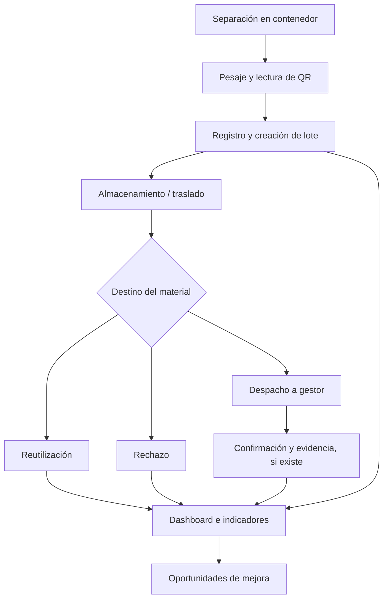

# 4. Solución consolidada: HubCircular

El sistema se organiza en cuatro pilares:

| Pilar | Objetivo | Ejemplo |
|---|---|---|
| **Registro** | Capturar peso, material, ubicación y responsable | Registrar 5,2 kg de cartón |
| **Trazabilidad** | Seguir lotes, almacenamientos y destinos | Despachar 3 kg y conservar 2,2 kg |
| **Análisis** | Convertir registros en KPIs y tendencias | Comparar dos semanas |
| **Mejora** | Detectar acciones ambientales concretas | Sugerir cambio de frecuencia de retiro |

## Flujo lógico

La **confirmación de destino** es distinta del despacho. Que un tercero retire un material no demuestra automáticamente que fue reciclado.

---

[← Volver al índice de la semana 11](README.md)
