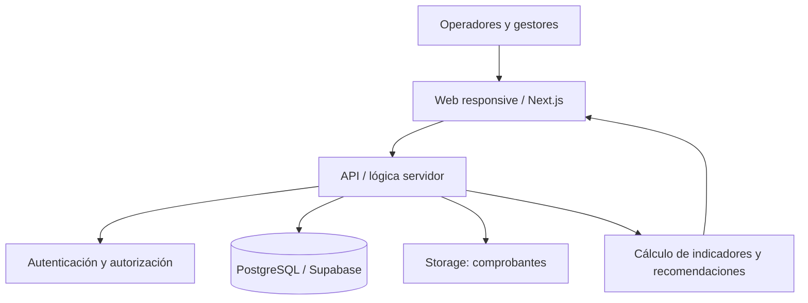

# 12. Arquitectura técnica

## Opción recomendada: monolito web modular

**Frontend y servidor:** Next.js + TypeScript.  
**Interfaz:** Tailwind CSS + shadcn/ui.  
**Datos:** PostgreSQL alojado en Supabase.  
**Autenticación:** Supabase Auth y roles.  
**Almacenamiento de evidencia:** Supabase Storage.  
**Gráficos:** Recharts.  
**Pruebas:** Vitest + Playwright.  
**Colaboración:** GitHub.

**Razón de la elección:** reduce despliegues y componentes separados respecto de Next.js + NestJS + Prisma, y sigue permitiendo modularidad. La opción NestJS/Prisma/PostgreSQL del compañero también es viable si la evaluación académica exige un backend independiente.

## Principio técnico crítico

Crear mediciones y movimientos con **validación del lado del servidor**. Registrar salida, validar disponibilidad y modificar saldos en una **transacción atómica de base de datos**. Implementar idempotencia para que repetir una solicitud no duplique registros.

No incluir IoT ni IA en el MVP: primero debe funcionar correctamente el proceso humano de pesaje y registro.

---

[← Volver al índice de la solución 1](README.md)
