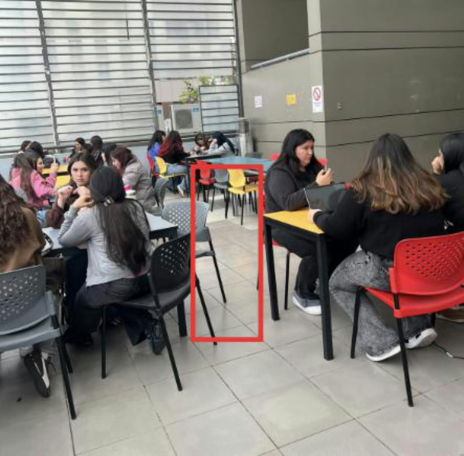
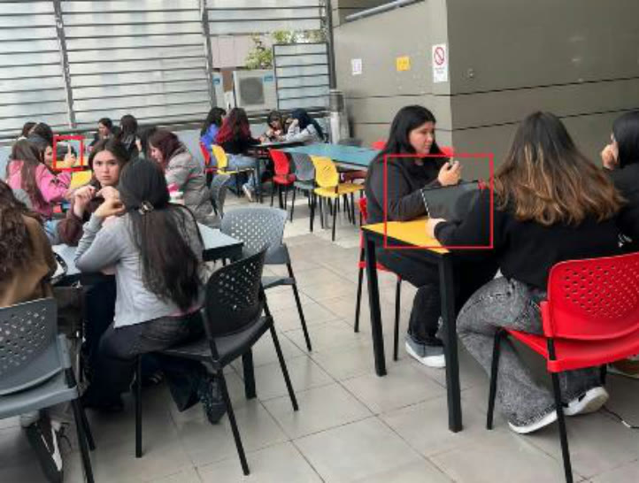
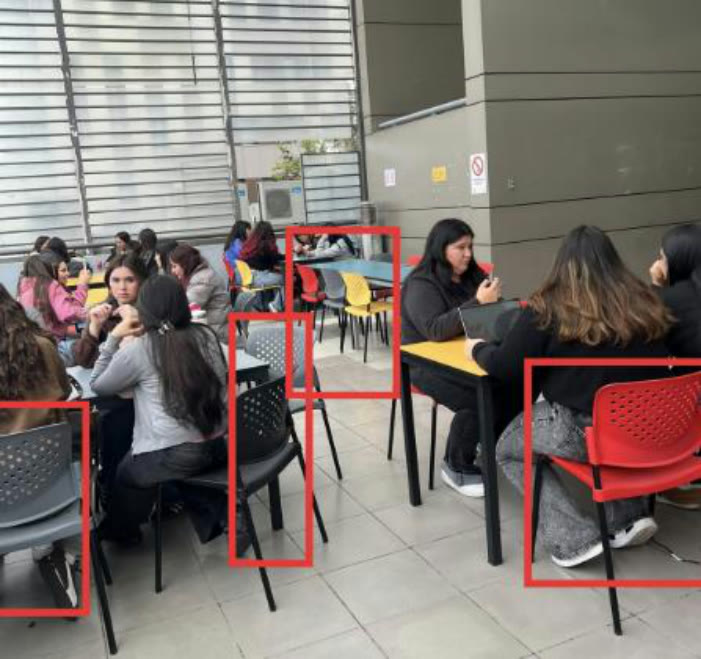
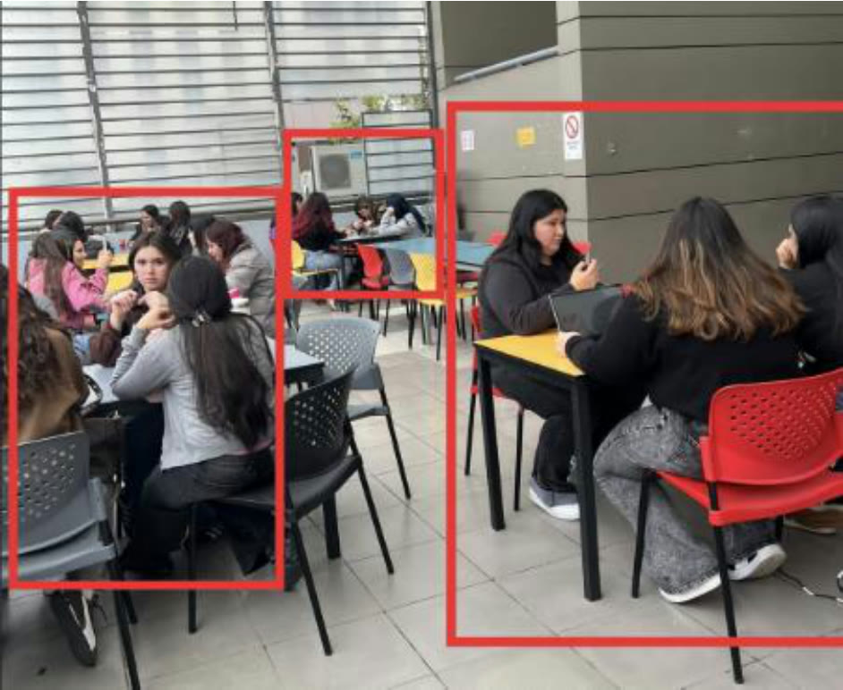

# 4. Registro Individual

## 4.1 Accesibilidad, seguridad y dificultades de uso (Fernanda López)

* **Observaciones:** Se utilizan sillas y mesas, además de pequeños pasillos entre cada mesa.
* **Supuesto asociado:** Se dificulta el paso al ser un espacio pequeño, donde algunas mesas están más juntas que otras. También se dificulta usar dispositivos que dependen de un cargador, porque hay pocos enchufes.
* **¿Qué faltaría saber para confirmarlo?** Volver en un momento en que el lugar esté más lleno, aunque ya era complicado moverse.

## 4.2 Información, objetos y tecnología (Carlos Concha)

* **Observaciones:** La mayoría de las personas está sentada usando su teléfono o computador. Es casi un ambiente de cowork al aire libre.
* **Supuesto asociado:** El lugar es tranquilo y silencioso; por eso las personas se quedan allí cuando no hay mucha gente y lo usan como espacio recreativo y de estudio.
* **¿Qué faltaría saber para confirmarlo?** Según el registro, nada adicional: el lugar se percibe muy tranquilo.

## 4.3 Espacio e infraestructura (Vicente Lizama)

* **Observaciones:** El espacio se compone de mesas, sillas y pasillos delimitados por el mismo mobiliario. Al no ser un espacio muy grande y tener muchas mesas, en ciertos horarios se acumula mucha gente.
* **Supuesto asociado:** El lugar se llena en los horarios libres, por lo general a la hora de almuerzo (alrededor de las 13:00).
* **¿Qué faltaría saber para confirmarlo?** Permanecer más tiempo en el lugar para confirmar el supuesto.

## 4.4 Conductas e interacciones (Débora Cáceres)

* **Observaciones:** Las personas entran desde el pasillo y todas vienen con el mismo propósito. Usan el lugar como punto de encuentro social, de estudio o como zona de fumadores.
* **Supuesto asociado:** Al ser una terraza, podría tratarse de una zona de fumadores, lo que no implica que todos los estudiantes estén de acuerdo o fumen. Esto podría generar malos ratos a quienes no fuman.
* **¿Qué faltaría saber para confirmarlo?** Corroborarlo conversando con los estudiantes.

---

[← Volver al índice de la semana 11](README.md)
