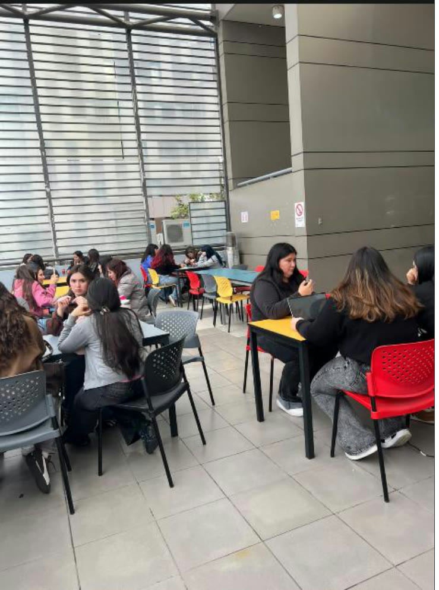

# 7. Conexión con el Proyecto Capstone

El equipo eligió una afirmación que estaba tratando como un hecho y la cuestionó con la misma lógica del ejercicio.

| Pregunta | Respuesta |
| :-- | :-- |
| **Afirmación** | Es un lugar cómodo para estudiar. |
| **¿Es hecho, interpretación o supuesto?** | Es una **interpretación**. |
| **¿Qué evidencia tenemos hoy?** | La fotografía del espacio tomada durante la observación. |
| **¿Qué evidencia necesitamos obtener para comprobarla?** | Una encuesta que pregunte a las personas si prefieren estudiar en la terraza en vez de otros lugares y por qué. |

---

[← Volver al índice de la semana 11](README.md)
