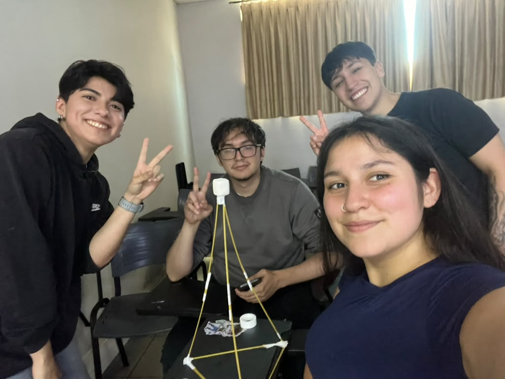

# 5. Desafío del Marshmallow

**Objetivo:** construir la torre autoportante más alta posible, capaz de sostener un marshmallow completo en la punta.

## 5.1 Materiales por equipo

| Material | Cantidad |
| :-- | :-- |
| Espaguetis (fideos crudos) | 18 |
| Cinta adhesiva | 1 metro |
| Marshmallow | 1 unidad |

## 5.2 Reglas

* El marshmallow debe quedar completo y en la parte superior.
* Se pueden romper los fideos y cortar la cinta.
* La torre debe mantenerse sola, sin manos, paredes ni apoyos externos.
* Al terminar el tiempo, nadie puede tocar ni sostener la estructura.
* Gana la torre estable que sostenga el marshmallow a mayor altura medida desde la mesa.

## 5.3 Estructura construida por el equipo

* **Forma:** estructura piramidal, con las aristas convergiendo en un vértice superior donde se ubicó el marshmallow.
* **Base:** los espaguetis se pegaron **lado a lado, de a dos**, para ganar estabilidad.
* **Aristas superiores:** los espaguetis que convergen en el vértice que sostiene el marshmallow se pegaron **uno sobre otro**, para ganar altura.
* **Vértices:** antes de montar, se definió cuántos fideos llegarían a cada vértice y cómo se unirían con la cinta.

---

[← Volver al índice de la semana 13](README.md)
