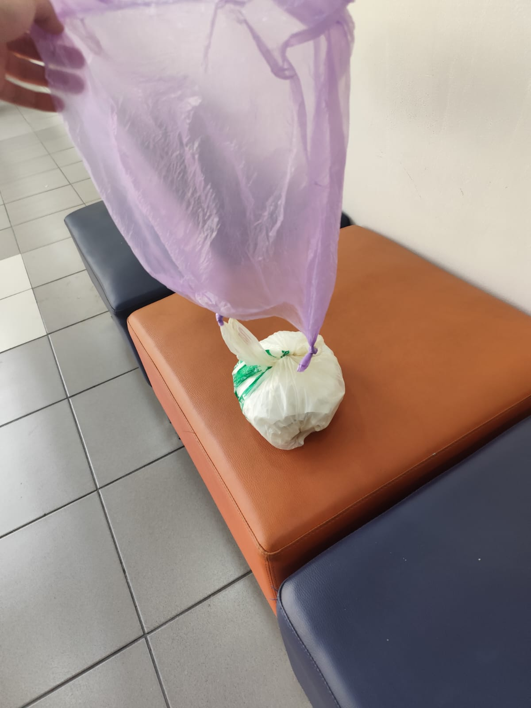
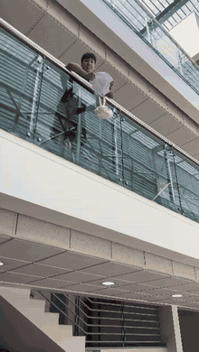

# 6. Egg Drop Challenge

**Objetivo:** diseñar un dispositivo que proteja un huevo en una caída controlada.

> No basta con que el huevo sobreviva. Otro equipo debe poder comprender qué diseñamos, cómo lo probamos, qué resultados obtuvimos y qué evidencia respalda nuestras conclusiones.

## 6.1 Cuatro principios para proteger el huevo

No existe una única solución, pero todo diseño debe considerar:

| Principio | Qué significa |
| :-- | :-- |
| **1. Amortiguar** | Agregar zonas deformables para disipar la energía del impacto. |
| **2. Sujetar** | Evitar que el huevo golpee contra su propio contenedor. |
| **3. Estabilizar** | Controlar la orientación y reducir impactos secundarios. |
| **4. Probar** | Detectar puntos débiles y rediseñar antes del lanzamiento. |

## 6.2 Reglas de la prueba

* Altura común y zona de caída protegida.
* No intervenir durante la caída.
* El huevo debe poder sacarse del sistema de protección para documentar su estado.

## 6.3 Diseño final del equipo

Tras el primer lanzamiento fallido (ver [registro de evidencia](7_registro_evidencia.md)), el equipo llegó a este diseño:

| Principio | Cómo lo aplicamos |
| :-- | :-- |
| **Amortiguar** | Base del contenedor reforzada **por dentro y por fuera** con toallas de papel y papel higiénico, en la zona que recibe el golpe. |
| **Sujetar** | Huevo **envuelto en papel** en el interior, para que quede firme y no choque contra las paredes del envase. |
| **Estabilizar** | **Mini paracaídas** hecho con una bolsa plástica, que controla la orientación de la caída y reduce la fuerza del impacto. |
| **Probar** | Un primer lanzamiento para encontrar los puntos débiles y un segundo lanzamiento con el diseño corregido. |

*Prototipo final: el contenedor con el huevo protegido, envuelto en una bolsa blanca, y el mini paracaídas morado amarrado a la parte superior.*

## 6.4 Segundo lanzamiento

*El prototipo se suelta desde la baranda del 5.º piso, el paracaídas se abre y el contenedor aterriza en el 4.º piso con el huevo intacto. [Ver el video original](assets/lanzamiento_2.mp4).*

---

[← Volver al índice de la semana 14](README.md)
