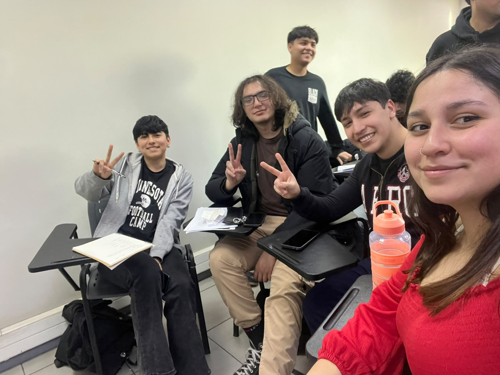

# ENTREGABLE DE BITÁCORA: CONTRATO DE EQUIPO Y MINUTA DE 1° REUNIÓN

**Proyecto:** Gestión y Medición de Residuos Reciclables del Hub Providencia (Desafío 04 | Sostenibilidad)

**Entidad Contraparte:** Municipalidad de Providencia / Hub Providencia

**Fecha de Emisión:** Agosto 2026

## PARTE I: MINUTA DE 1° REUNIÓN DE EQUIPO

### 1. Información General de la Sesión

* **Fecha:** 20 de agosto de 2026
* **Hora de Inicio / Cierre:** 15:30 - 16:40 hrs
* **Modalidad / Lugar:** Sesión Híbrida / Sala de Trabajo Colaborativo
* **Asistencia:** 100% de los integrantes presentes

### 2. Fotografía del Equipo

Fotografía grupal capturada durante la primera sesión de conformación y arranque de proyecto.

### 3. Identidad del Equipo

* **Nombre del Equipo:** HubCircular
* **Lema del Equipo:** *"Datos precisos que transforman residuos en valor colectivo."*
* **Propósito / Misión:** Desarrollar una solución integral y sencilla de registro, medición y visualización de indicadores de reciclaje para fortalecer la economía circular y la toma de decisiones en el Hub Providencia.

### 4. Definición del Desafío

* **Pregunta Orientadora:** ¿Cómo podríamos facilitar la gestión y medición de los residuos reciclables generados en el edificio del Hub Providencia?
* **Contexto y Problemática:** En el edificio del Hub Providencia se generan periódicamente diversos tipos de residuos con potencial de reciclaje; sin embargo, no existe un sistema consolidado y estandarizado para cuantificar, monitorear y analizar los volúmenes recuperados. Esto dificulta la visibilidad del impacto ambiental, la toma de decisiones basada en datos y el fomento activo de hábitos sostenibles en la comunidad de usuarios.
* **Objetivo General del Proyecto (SMART):** Diseñar, validar e implementar un prototipo funcional de sistema de registro, protocolo de medición piloto y panel de indicadores ambientales para el Hub Providencia, asegurando que el 100% de las mediciones generen datos comparables y transferibles para su operación autónoma en un plazo de 8 semanas.

### 5. Valores del Equipo

1. **Responsabilidad y Rigor:** Cumplimiento estricto de las fechas de entrega acordadas y entrega de resultados con alta calidad técnica.
2. **Transparencia y Comunicación Proactiva:** Visibilidad inmediata de dificultades, riesgos, bloqueos o retrasos sin penalización social.
3. **Centrado en el Usuario (Hub):** Priorizar soluciones intuitivas, prácticas y de bajo roce operativo para el equipo de administración y usuarios del edificio.
4. **Colaboración y Apoyo Mutuo:** Enfoque interdisciplinario donde los conocimientos se comparten y se brinda soporte activo ante sobrecargas de trabajo.

### 6. Normas de Trabajo y Acuerdos de Convivencia

* **Canales de Comunicación:** Grupo oficial de mensajería instantánea (Whatsapp) para coordinaciones rápidas y tablero en línea para el seguimiento de tareas. Tiempo máximo de respuesta: 24 horas en días hábiles.
* **Puntualidad en Reuniones:** Tolerancia máxima de espera de 5 minutos al inicio de cada sesión. Las reuniones no superarán los 45-60 minutos y contarán con tabla de temas previa.
* **Gestión de Entregables:** Las tareas asignadas deben subirse con un mínimo de 24 horas antes de la entrega final para permitir la revisión cruzada.
* **Manejo de Discrepancias:** En caso de divergencia de criterios, se evaluará la alternativa técnica más viable según los requerimientos del usuario; si no hay consenso tras 15 minutos de debate, se resolverá por votación simple o criterio del líder de proyecto.

### 7. Declaración de Compromisos Individuales SMART por Integrante

| **Integrante / Rol** | **Declaración de Compromiso SMART** | **Plazo y Verificación** |
| --- | --- | --- |
| **Débora Cáceres**  *Líder / Project Manager* | Coordinar el 100% de las sesiones semanales, centralizar la comunicación con la contraparte de Hub Providencia y mantener el cronograma de trabajo actualizado sin desviaciones superiores a 48 horas. | Semanalmente / Registro de actas y tablero de avance. |
| **Fernanda López**  *Investigación y Metodología* | Diseñar y documentar la metodología de medición, clasificación y pesaje para el espacio piloto, cubriendo al menos 3 categorías de residuos con sus respectivas planillas operativas antes del término de la Semana 4. | Semana 4 / Documento metodológico y fichas de muestreo. |
| **Vicente Lizama**  *Diseño UX / Prototipado* | Diseñar los flujos de captura de datos y realizar pruebas de usabilidad con al menos 3 operadores/usuarios del Hub Providencia, logrando una tasa de completitud de tareas superior al 85% antes de la Semana 6. | Semana 6 / Prototipo interactivo y reporte de usabilidad. |
| **Carlos Concha**  *Desarrollo y Analítica de Datos* | Construir e integrar el panel de indicadores (dashboard) que visualice métricas clave de pesaje, tasa de recuperación y destino final, validado con un set de datos de prueba completo antes de la Semana 7. | Semana 7 / Dashboard operativo y manual de conexión de datos. |

## PARTE II: CONTRATO DE EQUIPO

Por medio del presente documento, las y los integrantes del equipo **HubCircular** declaran conocer y aceptar las siguientes cláusulas que regirán su funcionamiento durante el desarrollo del desafío:

### Cláusulas del Acuerdo

* **Cláusula 1 (Compromiso Operativo):** Cada integrante se compromete a ejecutar con autonomía, rigor y puntualidad los compromisos SMART definidos en la matriz de roles y responsabilidades.
* **Cláusula 2 (Cultura de Feedback):** Las sesiones de trabajo incluirán revisiones constructivas de pares, manteniendo siempre el foco en la mejora técnica del entregable y el respeto mutuo.
* **Cláusula 3 (Gestión de Contingencias):** Ante eventuales ausencias justificadas o emergencias, el integrante afectado deberá notificar con al menos 12 horas de anticipación y transferir el estado de sus pendientes a un compañero de respaldo.
* **Cláusula 4 (Propiedad y Calidad del Trabajo):** Todos los entregables producidos deberán cumplir con los estándares académicos y profesionales requeridos, asegurando la entrega a tiempo de la bitácora consolidada.