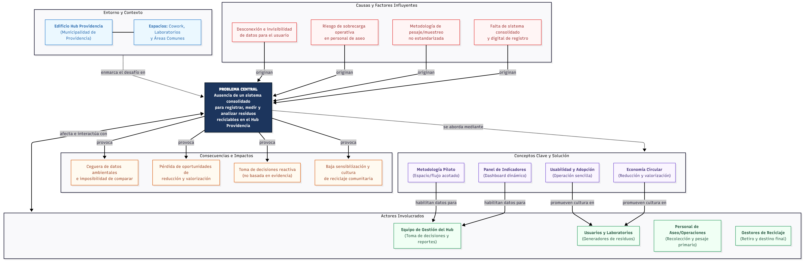

# 1. MAPA CONCEPTUAL DEL DESAFÍO

**Diagrama del Sistema**

## Componentes del Mapa

* **Problema Central:** Inexistencia de un sistema consolidado de registro, medición y análisis de residuos reciclables en el edificio Hub Providencia.
* **Contexto:** Edificio Hub Providencia (Municipalidad de Providencia), compuesto por laboratorios, espacios de cowork, oficinas administrativas y áreas comunes.
* **Causas y Factores:** Falta de herramientas digitales centralizadas, ausencia de metodología estandarizada de pesaje, riesgo de sobrecarga operativa en personal de aseo y desinformación/invisibilidad de datos hacia los usuarios.
* **Consecuencias e Impactos:** Ceguera de datos ambientales, toma de decisiones reactiva, pérdida de oportunidades de valorización/economía circular y baja sensibilización comunitaria.
* **Actores Involucrados:** Equipo de gestión del Hub, usuarios de laboratorios/cowork, personal de aseo/operaciones y gestores/recolectores externos de reciclaje.
* **Conceptos Clave:** Economía circular, tasa de recuperación/valorización, panel de control (dashboard), metodología piloto y usabilidad/adopción técnica.

---

[← Volver al índice de la semana 3](README.md)
