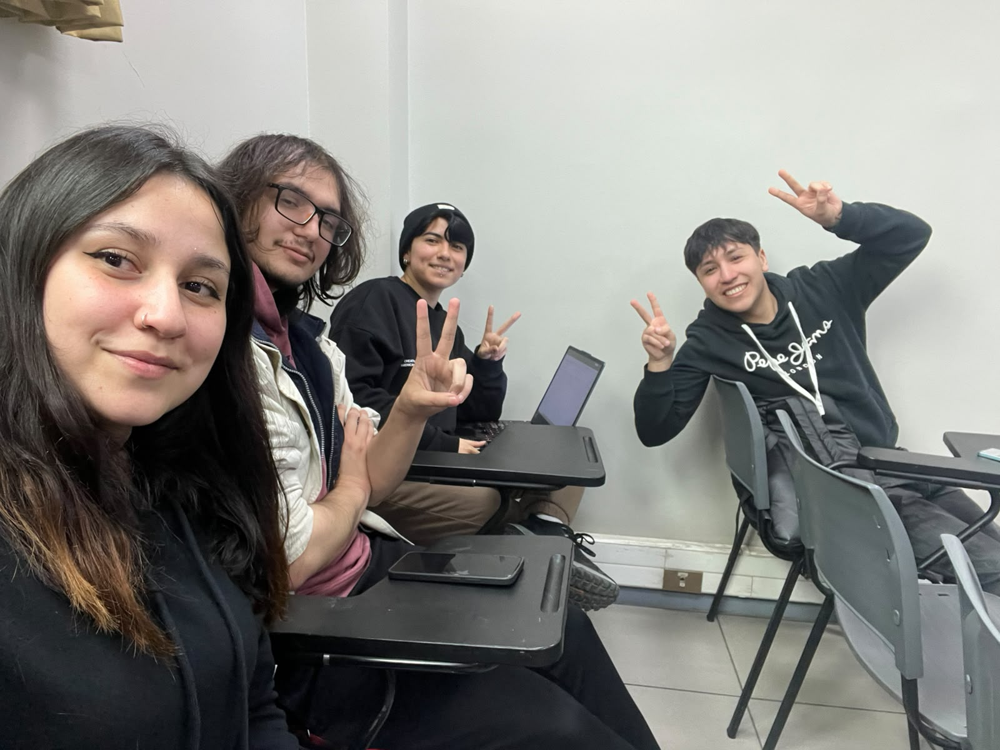

# FICHA DE DIAGNÓSTICO: ¿DÓNDE ESTAMOS?

**Proyecto:** Gestión y Medición de Residuos Reciclables del Hub Providencia (Desafío 04 | Sostenibilidad)  
**Equipo:** HubCircular

---

### Fotografía del Equipo

Fotografía grupal capturada durante la sesión de trabajo de la semana 4.

---

### 1. ¿Qué está ocurriendo?
*(El problema observable, sin mencionar una solución)*  
En el edificio del Hub Providencia se generan periódicamente diversos tipos de residuos con potencial de reciclaje, pero no se cuenta con un sistema consolidado que permita registrar, medir y analizar su volumen de generación ni su recuperación real. Los registros son inexistentes o se encuentran completamente dispersos, lo que impide conocer la magnitud de los residuos producidos y su destino final.

---

### 2. ¿A quién le ocurre?
*(Usuario/actor específico afectado)*  
Al **Equipo de Gestión y Administración del Hub Providencia**, junto al **Personal de Aseo y Servicios Operativos del recinto**. Los primeros no cuentan con datos duros para gestionar presupuestos, cumplir directrices municipales ni evaluar metas ambientales; los segundos deben manejar físicamente los residuos a diario sin procedimientos estandarizados ni claridad en los flujos internos de segregación.

---

### 3. ¿Por qué importa?
*(Señala 3 consecuencias concretas del problema)*  
1. **Ceguera de datos y decisiones reactivas:** La administración opera a ciegas, sin posibilidad de comparar períodos de tiempo ni fundamentar decisiones operativas y presupuestarias en evidencia verificable.
2. **Pérdida neta de materiales valorizables:** Residuos que podrían incorporarse a circuitos de economía circular terminan en vertederos como basura convencional por falta de separación y trazabilidad en el origen.
3. **Desmotivación y desconfianza en la comunidad:** Las personas usuarias no perciben el impacto de sus acciones y dudan de la efectividad del reciclaje, lo que desincentiva la adopción de hábitos sostenibles dentro del edificio.

---

### 4. ¿Qué sabemos?
*(Enumeren 15 cosas que saben)*  
1. El edificio cuenta con contenedores exteriores diferenciados para papel y cartón.
2. Existen contenedores exteriores destinados al acopio de botellas de vidrio.
3. El recinto dispone en el exterior de contenedores para envases livianos.
4. En los espacios interiores predominan basureros convencionales para basura común.
5. No existen puntos limpios interiores visibles ni estandarizados para separar desde el origen.
6. El edificio alberga diversos tipos de espacios: laboratorios, cowork, oficinas y zonas comunes.
7. Existe un flujo constante y rotativo de usuarios que transitan por las instalaciones.
8. Actualmente no existe una metodología estandarizada para el pesaje periódico de residuos.
9. Los datos sobre el volumen total de residuos recuperados son inexistentes o se hallan dispersos.
10. La administración del edificio no cuenta con un dashboard o panel centralizado de métricas ambientales.
11. La Municipalidad de Providencia exige directrices institucionales vinculadas a sostenibilidad y economía circular.
12. La administración del Hub tiene la necesidad recurrente de justificar presupuestos destinados a la gestión del edificio.
13. El personal de aseo y mantenimiento teme que incorporar nuevas tareas de registro incremente su carga laboral diaria.
14. Las personas que visitan y trabajan en el Hub expresan dudas sobre qué ocurre finalmente con los residuos que depositan.
15. Las iniciativas de reciclaje que se han promovido no cuentan con datos cuantitativos que respalden su efectividad real.

---

### 5. ¿Qué creemos pero aún no sabemos?
*(2 - 3 supuestos)*  
1. **Supuesto sobre carga operativa:** Creemos que el personal de aseo rechazará cualquier sistema de registro que requiera más de 2 minutos por pesaje o que altere sus rutinas críticas de limpieza.
2. **Supuesto sobre comportamiento del usuario:** Creemos que las personas usuarias y miembros de laboratorios no separan residuos principalmente por falta de infraestructura cercana y señalética clara, y no por desinterés o falta de conciencia ambiental.
3. **Supuesto sobre adopción institucional:** Creemos que el equipo de gestión del Hub utilizará de forma continua los indicadores ambientales solo si estos son directamente exportables para reportes municipales y decisiones de presupuesto.

---

### 6. ¿Qué necesitan averiguar y todavía no saben?
*(4 preguntas prioritarias)*  
1. ¿Cómo se realiza operativamente el flujo actual de traslado de los residuos desde los basureros interiores hacia los contenedores de acopio exterior?
2. ¿Qué volumen y tipos específicos de residuos generan prioritariamente los laboratorios técnicos en comparación con las áreas de cowork y oficinas?
3. ¿Cuáles son las rutinas, horarios y capacidades de tiempo reales del personal de aseo para ejecutar un protocolo de pesaje sin sobrecargarse?
4. ¿Existe un convenio con gestores o recolectores de base que garantice, certifique y entregue trazabilidad del destino final de los materiales retirados?