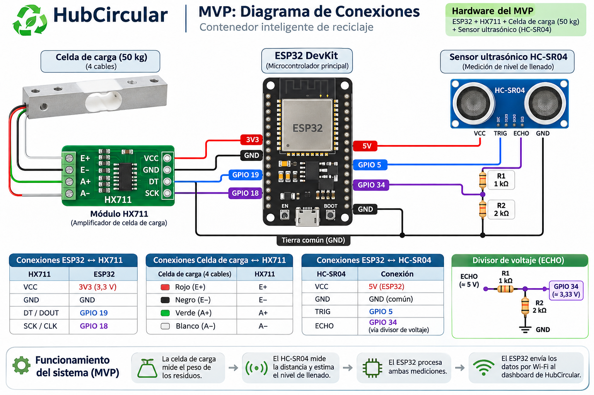

# 3. Conexiones

> Antes de conectar, confirmar el modelo de cada módulo y que los pines estén disponibles en el shield. **Todos los módulos comparten GND.**



## 3.1 HX711 → ESP32

| Pin HX711 | Pin ESP32 |
| :-- | :-- |
| VCC | 3V3 (verificar que el módulo acepte 3,3 V) |
| GND | GND |
| DT / DOUT | GPIO 19 |
| SCK / CLK | GPIO 18 |

## 3.2 Celda de carga → HX711

| Cable (colores habituales) | Pin HX711 |
| :-- | :-- |
| Rojo | E+ |
| Negro | E− |
| Verde | A+ |
| Blanco | A− |

Los colores pueden variar según el fabricante: hay que confirmarlos con la hoja de datos de la celda recibida. Si el peso aumenta en negativo al cargar la celda, se invierten A+ y A− (o el signo del factor de calibración).

## 3.3 Sensor ultrasónico HC-SR04 → ESP32

| Pin HC-SR04 | Conexión |
| :-- | :-- |
| VCC | 5 V (pin VIN o 5V del ESP32, alimentado por USB) |
| GND | GND común |
| TRIG | GPIO 5 |
| ECHO | GPIO 34, **a través del divisor de voltaje** |

El ECHO entrega unos 5 V y las entradas del ESP32 solo toleran 3,3 V:

```
ECHO ──[1 kΩ]──┬── GPIO 34
               │
             [2 kΩ]
               │
              GND
```

Voltaje en el GPIO 34: 5 V × 2 / (1 + 2) ≈ **3,33 V**. El GPIO 34 es solo de entrada, lo que sirve para ECHO.

Si el sensor recibido es una versión de 3,3 V (por ejemplo, HC-SR04P o RCWL-1601), se puede alimentar con 3V3 y no necesita divisor.

## 3.4 Resumen de pines

| GPIO | Uso |
| :-- | :-- |
| 2 | LED integrado (estado, H6) |
| 5 | TRIG del ultrasónico |
| 18 | SCK del HX711 |
| 19 | DT del HX711 |
| 34 | ECHO del ultrasónico (con divisor) |

## 3.5 Alimentación

* **Desarrollo:** cable USB al notebook.
* **Feria:** cargador USB de 5 V (H7). No se usa la batería de 9 V.

---

[← Volver al índice del MVP del hardware](README.md)
