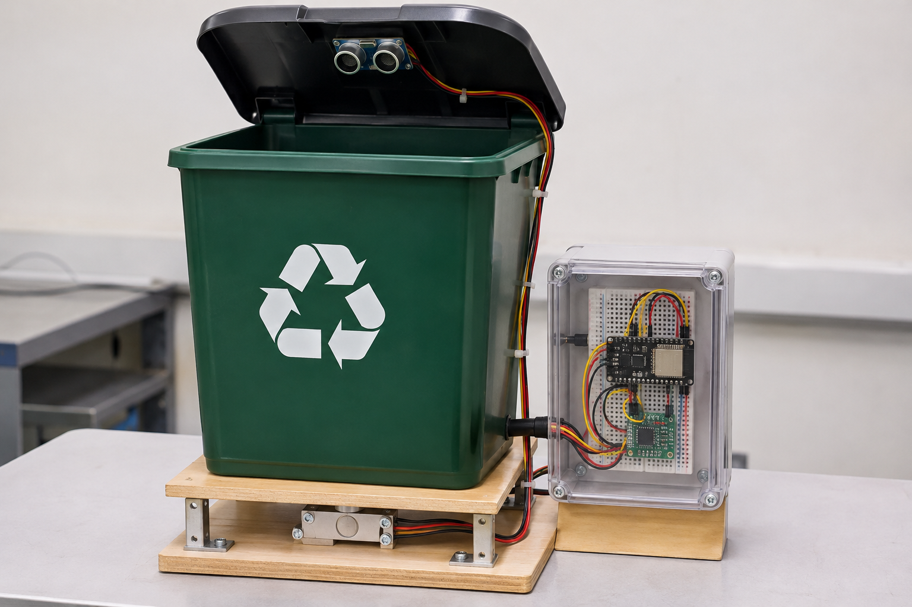

# 5. Montaje del Contenedor



*Imagen referencial generada para visualizar el diseño. **No es una fotografía del prototipo construido**; las fotos reales se agregarán cuando se monte.*

El diseño considera:

* Contenedor sobre una **plataforma de madera** con la celda de carga entre la base y la plataforma.
* **Sensor ultrasónico** en la tapa, apuntando hacia los residuos.
* **Caja transparente** al costado con el ESP32, el HX711 y la protoboard, para que los visitantes de la feria vean la electrónica.

Al construirlo hay que corregir dos detalles de la imagen:

| Detalle en la imagen | Problema | Corrección |
| :-- | :-- | :-- |
| Soportes metálicos en las esquinas que unen la plataforma con la base | Parte del peso se iría por los soportes y no por la celda, y la medición quedaría por debajo del peso real. | La plataforma debe apoyarse **solo en la celda**. Los soportes laterales, si se usan, deben quedar con holgura y sin tocar la plataforma. |
| Sensor en una tapa que se abre | Con la tapa abierta, el sensor apunta hacia un lado y mide cualquier cosa. | Medir el llenado **solo con la tapa cerrada** (el firmware descarta lecturas fuera de rango) o fijar el sensor en un soporte fijo sobre el borde del contenedor. |

## 5.1 Sistema de pesaje

```
        ┌──────────────────────┐
        │      Contenedor      │
   ═════╧══════════════════════╧═════   ← plataforma superior
                 ┌──┴──┐
                 │     │ ← separador
   ──────────────┤CELDA├──────────────   (celda de barra, en voladizo)
                 │     │ ← separador
   ═══════════════════════════════════   ← base inferior
```

* La celda de barra se atornilla **por un extremo a la base** y **por el otro a la plataforma**, con separadores que dejen espacio para que se flecte.
* El peso debe pasar **solo por la celda**: la plataforma no debe tocar la base ni ningún otro apoyo.
* Respetar la **flecha** grabada en la celda (indica el sentido de la carga).
* Peso total (contenedor + plataforma + residuos) por debajo de la capacidad de la celda, con margen.
* La electrónica va fija a la base, lejos de donde caen los residuos.

## 5.2 Sensor de llenado

* Se instala en la **tapa**, apuntando hacia el fondo.
* Debe quedar al menos a **5 cm** del nivel máximo de llenado (el HC-SR04 no mide bien a menos de 2–3 cm).

```
nivel_pct = (distancia_vacío − distancia_medida) / (distancia_vacío − distancia_lleno) × 100
```

El resultado se limita al rango 0–100 %. `distancia_vacío` y `distancia_lleno` se miden en el contenedor real.

La medición es **aproximada**: los residuos son irregulares y no se distribuyen de forma pareja.

---

[← Volver al índice del MVP del hardware](README.md)
