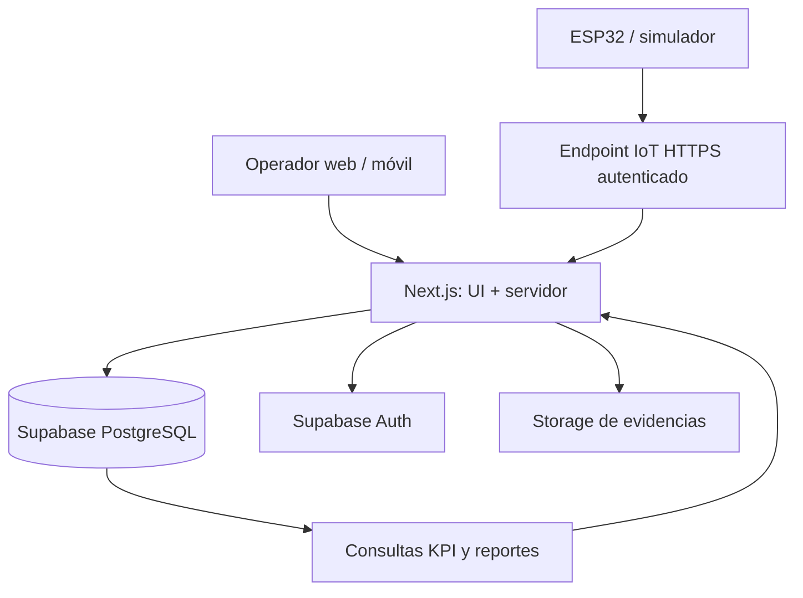

# 02 · Arquitectura técnica propuesta

## Arquitectura: monolito web modular

## Stack sugerido (por verificar al iniciar)
- Next.js App Router + TypeScript estricto.
- Tailwind CSS y componentes accesibles shadcn/ui.
- PostgreSQL (Supabase) + Supabase Auth + Storage según necesidades.
- Recharts para gráficos; Vitest para lógica y Playwright para flujos E2E.
- Entorno local con variables `.env.example`, migraciones y semillas; GitHub.

## Módulos de dominio
1. `identity` — usuarios, roles, ámbito.
2. `catalog` — edificios, zonas, estaciones, contenedores, materiales.
3. `weighing` — pesajes validados y creación de lotes.
4. `inventory` — movimientos y saldos transaccionales.
5. `destination` — terceros, retiros, evidencias, confirmación.
6. `telemetry` — registro de sensores, estado y dispositivos.
7. `analytics` — KPI, comparaciones y alertas explicables.
8. `audit` — eventos administrativos y correcciones.

## Límites imprescindibles
- La **web** o servidor de aplicación recibe datos; un ESP32 no se conecta directamente a PostgreSQL con credenciales administrativas.
- API IoT consume telemetría. Eventos de captación/transporte se crean por flujo de negocio distinto y autorizado.
- Seguridad de dispositivos: credenciales por dispositivo, almacenadas como hash en backend cuando aplique; el firmware contiene solo su propio secreto rotativo, nunca una clave de servicio Supabase. Para producción, transporte HTTPS y verificación de certificado.
- Los saldos se mantienen mediante movimientos y restricciones transaccionales; no confiar en valores enviados desde el navegador.
- La autorización de usuarios debe cumplir tanto las políticas DB (RLS si se exponen consultas directas) como validación servidor.

## Modelo de implementación
- Endpoints HTTP para recursos necesitados por cliente externo/simulador.
- Acciones del servidor para mutaciones de la UI donde convenga.
- Consultas agregadas SQL/vistas/RPC en servidor y filtros de autorización.
- Separar tablas `sensor_readings` de `weighings`, `batches` y `movements`.
- Fechas almacenadas como `timestamptz` UTC; visualización en `America/Santiago` para reportes locales.
- Imágenes de diseño son referencias no implementadas.

## Decisiones a validar
Proveedor de despliegue, presupuesto, dominio, cuentas organizacionales, permisos y política de retención. No asumir acceso real a Supabase antes de configurarlo.

> **Estado operativo (18-11-2026):** el ESP32 ejecuta un sketch de prueba por USB; HX711, celda de tres cables y Wi-Fi no tienen integración validada. La API IoT es un contrato de diseño, no un despliegue verificado. Consulta `docs/14-estado-actual-y-handoff.md`.
